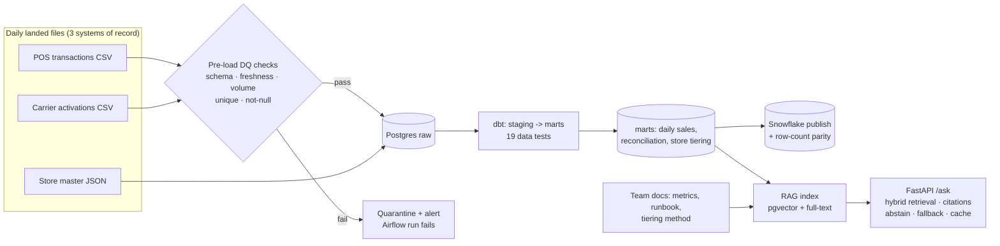

# Sales Analytics Platform: Pipeline, Tiering & RAG Assistant

An end-to-end sales data platform: multi-source ELT into PostgreSQL with pre-load data quality gates, dbt models (including a multi-factor store tiering model and cross-system reconciliation), Airflow orchestration, and a retrieval-augmented (RAG) assistant over the warehouse and team docs, with a ground-truth evaluation set.

All data is **synthetic** and generated by `data_gen/generate.py` (seeded, reproducible). Faults are injected on purpose so the checks can be scored against known ground truth.

## Architecture



Airflow DAG (`dags/sales_pipeline_dag.py`): `validate_and_load_pos` / `validate_and_load_carrier` -> `dbt_build` -> `publish_to_snowflake` + `refresh_rag_index`, plus a watcher task that fails the run if anything upstream failed.

## Results (measured, `results/*.json`)

| Area | Result |
|---|---|
| Volume | 735,733 POS rows + 168,825 carrier rows loaded across 120 stores x 180 days (360 daily batches) |
| Data quality | **10 / 10** injected bad files caught (schema drift, missing file, volume drop, duplicates, null keys, stale re-send), **0** false alarms, **0** silent failures, 2,498 check results logged |
| Orchestration | Airflow 3.1 `dags test`: clean day ends green; missing-file day ends **failed** with alert (see "Silent-failure fix" below) |
| dbt | 9 models, 19 data tests, all passing |
| Reconciliation | 171 / 171 injected orphan activations and 174 / 174 store mismatches found (precision 1.0) on the 170 dates where both systems loaded |
| Store tiering | Scored on Jan-Apr, validated on May-Jun holdout: tiers perfectly ordered by future revenue; Platinum stores earned **5.4x** Bronze; Spearman rho 0.90 |
| Query tuning | (store_id, txn_ts) index: typical store/month query **37.8 ms -> 0.6 ms (63x)** |
| RAG retrieval | Held-out test split (27 answerable questions): hybrid **hit@1 92.6%, hit@3 96.3%, MRR 0.954** |
| RAG abstention | Threshold tuned on dev, on test: declines **70%** of unanswerable questions before calling the LLM while keeping **96%** of answerable ones |

### Honest caveats
- The data is synthetic, so the DQ and reconciliation scores show the checks work on known fault types, not how they'd do on messy real feeds.
- The composite tiering score predicts future revenue slightly *less* well than revenue alone (rho 0.90 vs 0.95). That's expected: tiering also rewards growth, attach and activation, not just size. It's reported here instead of hidden.
- The RAG ground-truth set is small (74 questions) and was visible during development, so treat the retrieval numbers as optimistic.
- Embeddings are local (TF-IDF + SVD) so the project needs no API keys; a hosted embedding model would likely retrieve better.

### Silent-failure fix
Airflow marks a run successful when its *leaf* tasks succeed. In testing, a day with a missing POS file failed the load task but still ended in a **green run**, because dbt and the downstream tasks succeeded on the other source. A `trigger_rule="one_failed"` watcher leaf now fails the run whenever any upstream task fails.

## Run it

Local (Postgres 16 + pgvector running, env vars `PGHOST PGUSER PGPASSWORD PGDATABASE` set):

```bash
pip install -r requirements.txt
./run_all.sh                       # generate -> load -> dbt build -> index -> evaluate -> tests
uvicorn rag.api:app --port 8000
curl -X POST localhost:8000/ask -H 'content-type: application/json' \
     -d '{"question": "Why is store S014 in its tier?"}'
```

Docker: `docker compose up --build` (Postgres + pgvector and the API).

Airflow (separate environment, it pins its own dependencies):
```bash
pip install "apache-airflow==3.1.0" apache-airflow-providers-standard \
  --constraint https://raw.githubusercontent.com/apache/airflow/constraints-3.1.0/constraints-3.11.txt
export AIRFLOW__CORE__DAGS_FOLDER=$PWD/dags
airflow db migrate && airflow dags test sales_daily_pipeline 2026-06-15
```

### Optional pieces that need your own accounts
- **LLM answers + LLM-as-judge eval:** set `ANTHROPIC_API_KEY`. Without it, `/ask` returns the best cited passage (extractive fallback). `python -m rag.eval.llm_judge` compares a baseline prompt with the guarded setup and writes accuracy and hallucination rate to `results/llm_judge_summary.json`.
- **Snowflake:** `pip install "snowflake-connector-python[pandas]"`, set `SNOWFLAKE_ACCOUNT/USER/PASSWORD`, run `python -m pipeline.snowflake_publish`. It loads the marts and checks Postgres vs Snowflake row counts.

## Layout

```
data_gen/generate.py        synthetic POS, carrier and store data + injected faults
pipeline/quality.py         pre-load checks (schema, freshness, volume, unique, not-null, known-store)
pipeline/extract_load.py    validate -> load or quarantine, idempotent per day, logs to ops.*
pipeline/snowflake_publish.py  optional publish + parity check
pipeline/evaluate.py        scores DQ, reconciliation, tiering and query tuning
dbt/                        staging + marts, store_tiering, reconciliation, tests
dags/                       Airflow DAG
rag/index.py                chunks docs + store cards + incident notes into pgvector
rag/retrieve.py             hybrid vector + full-text retrieval with RRF and metadata filter
rag/answer.py               grounded prompt, citations, abstention, fallback, cache, JSON logs
rag/api.py                  FastAPI service
rag/eval/                   ground-truth set, retrieval eval, LLM-as-judge
tests/                      unit + integration tests (pytest), run in CI
```
